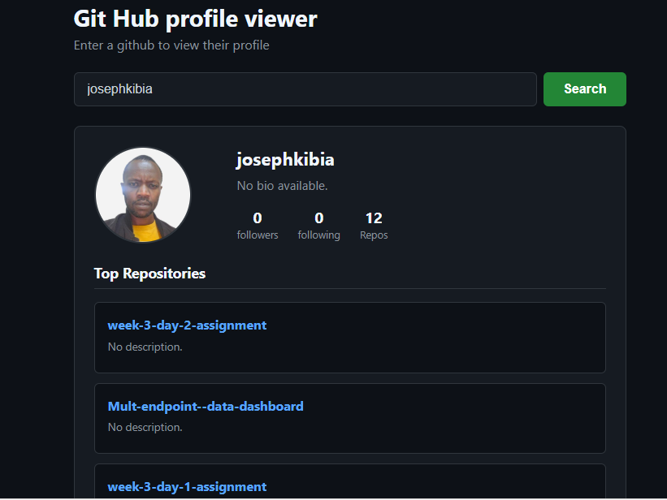

The project is shallowly designed just for viewing a github profile 

it makes use of Promise.all() to fetch parallel fetch operations to save time.
The viewer fetches a user profile and the their repos 
Below is a snapshot of the output from the viewer.
